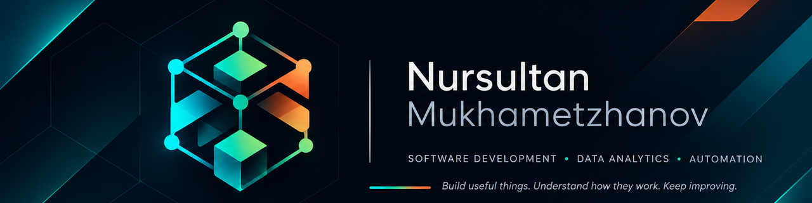

  

## Hi, I'm Nursultan 👋

I build practical software, automate routine workflows, and turn ideas into tools that are easy to use.

- **Languages:** Python, TypeScript, C# and Rust
- **Focus:** automation, terminal tools, web applications and data workflows
- **Currently exploring:** Rust and security fundamentals
- **Personal project:** Obsidian themes and productivity tooling

## Featured projects

| Project | About | Stack |
| --- | --- | --- |
| [digital-space](https://github.com/Nur5u1t4n/digital-space) | Personal website and digital workspace | Python |
| [neverforest](https://github.com/Nur5u1t4n/neverforest) | Everforest-inspired Obsidian theme | CSS |
| [fruit-ledger](https://github.com/Nur5u1t4n/fruit-ledger) | Personal finance and inventory project | TypeScript |
| [EverDesk](https://github.com/Nur5u1t4n/EverDesk) | Desktop utility project | C# |
| [permanent-taskbar-hider](https://github.com/Nur5u1t4n/permanent-taskbar-hider) | Windows taskbar utility | C++ |
| [dotfiles](https://github.com/Nur5u1t4n/dotfiles) | Reproducible Windows development environment | PowerShell |

## Technologies

  
  
  
  
  
  
  
  

## GitHub activity

  
  

## Contact

